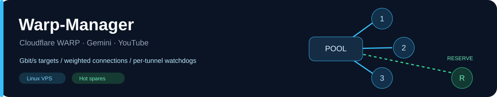
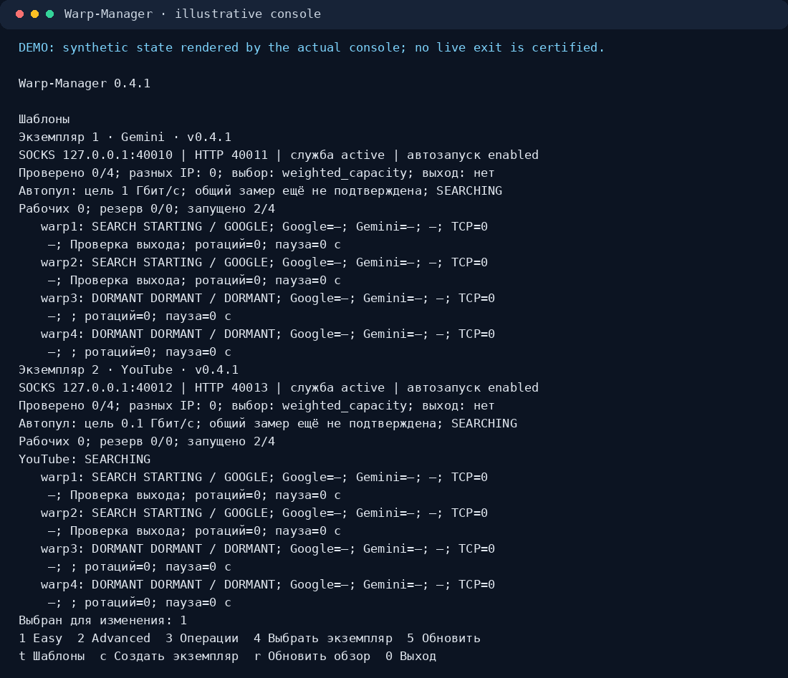

# Warp-Manager

[English](README.md) · [فارسی](README.fa_IR.md) · [العربية](README.ar_EG.md) · [中文](README.zh_CN.md) · [Español](README.es_ES.md) · [Русский](README.ru_RU.md) · [Türkçe](README.tr_TR.md)


Cloudflare WARP tunnel pools for Linux VPS servers: independent Gemini and YouTube policies, a local SOCKS5/HTTP front, per-tunnel watchdogs and optional capacity-driven scaling with hot spares.

[Quick start](docs/INSTALLATION.md) · [Configuration](docs/CONFIGURATION.md) · [Commands](docs/COMMANDS.md) · [Xray / 3x-ui](docs/xray/README.md) · [Operations](docs/OPERATIONS.md) · [Tests](docs/TESTING.md) · [FAQ](docs/FAQ.md)

**Version 0.4.1.** The installed command is `warp-pool`; existing `warp-google-pool` paths and service names are retained for compatibility. The console currently uses Russian labels. CLI flags are identical in every guide.

## Quick start

Requirements: root, Ubuntu/Debian x86_64, systemd, `/dev/net/tun`, Internet access and Python 3.10+. Ubuntu 24.04 / Python 3.12 was tested. Missing Docker/Compose/tools are installed when needed; preexisting Docker is preserved. The official WARP client is downloaded during the Docker build and started with `--accept-tos`.

From this full archive or a checkout:

```bash
cd Warp-Manager
sudo bash install.sh
```

With no arguments in a terminal, the installer opens the setup menu. Select Templates (`t`) for Gemini + YouTube, or create/edit an independent instance with Easy / Advanced.

After this repository has been uploaded to **Forcus356/Warp-Manager**, the standalone bootstrap is available:

```bash
curl -fsSL https://raw.githubusercontent.com/Forcus356/Warp-Manager/main/install_warp_manager.sh -o /tmp/install_warp_manager.sh
sudo bash /tmp/install_warp_manager.sh
```

The bootstrap resolves the requested ref to an immutable commit, downloads the complete source tree over HTTPS, checks its structure and prints the commit and ZIP checksum before calling the installer. See [installation details](docs/INSTALLATION.md) for pinning a source ref or using a local verified release.

```bash
# Independent Gemini pool; 1 Gbit/s is a target, not a measured promise.
sudo bash install.sh --instance 1 --role gemini --target-gbps 1 --tunnels 12 --impersonate
# Independent YouTube pool, with its own registrations and policy.
sudo bash install.sh --instance 2 --role youtube --target-gbps 1 --tunnels 12
warp-pool
warp-pool --all status
```

## Features

- Up to 99 independent instances, with 1–128 configured tunnel slots per instance. These are configuration bounds, not a VPS capacity guarantee.
- Fixed pools with failover or least-connections selection; optional automatic capacity mode with a weighted connection balancer.
- A target in **Gbit/s** (`0.1` = 100 Mbit/s), individual tunnel probes, then a simultaneous pool measurement. Separate probe sums never certify the aggregate target.
- Hot spares: `max(1, floor(primary_count / 3))`. Ten primary tunnels require three spares; thirty require ten. Spares take new traffic only after promotion, then the pool replenishes them.
- Separate health, service verdict, rotation limits, backoff and rejected-IP cache for every tunnel. Unused capacity slots remain dormant.
- Gemini requires an anonymous `SERVING` verdict. `REFUSED`, `CAPTCHA` and `INCONCLUSIVE` are not success.
- YouTube requires the observed Google region `RU`; Gemini checks are disabled on that separate instance. `RU VERIFIED` is a regional observation, not a no-ads or video-quality guarantee.
- Local SOCKS5, optional HTTP/CONNECT, private IPv4 binding, saved Xray outbound and combined domain-routing export.
- Staged updates, backups, persistent registration volumes and dependency-aware removal. Opening a menu never performs an implicit fresh probe.

WARP does not expose Psiphon-style country selection or a PIN for a specific exit server. Country lists filter **observed Google regions**, not the provider's chosen country. One TCP stream remains on one tunnel; multiple tunnels do not multiply its speed.

## Console previews

The following images are generated from the actual console renderers using **synthetic demonstration state**. They are not screenshots of verified live exits.



[Easy settings preview](docs/assets/easy-mode-preview.png) · [Templates preview](docs/assets/templates-preview.png) · [Plain text previews](docs/assets/menu-demo.txt)

## Common operations

```bash
warp-pool --instance 1 status --json
warp-pool --instance 1 check all --full
warp-pool --instance 1 speed all
warp-pool --instance 1 rotate warp2 --method registration
warp-pool --instance 1 logs -n 100
warp-pool --instance 1 capacity --gbps 1 --max-tunnels 12
warp-pool --instance 1 autostart on
warp-pool --instance 1 xray
warp-pool xray-routing --youtube-instance 2 --gemini-instance 1
```

`check`, `search`, `speed` and `rotate` enqueue work in the running monitor. A zero CLI exit code means the request was accepted; inspect `status`/`logs` for its result. `--all` is available for status, logs, config, xray and update, not destructive operations. The complete reference is in [COMMANDS](docs/COMMANDS.md).

## Xray and 3x-ui

The path is `Xray → local SOCKS5 → selected WARP tunnel → Internet`. Keep your existing default outbound first and merge the exported service rules before broad catch-all rules. The exporter does not edit the panel or restart Xray.

```bash
warp-pool xray-routing --youtube-instance 2 --gemini-instance 1 > warp-routing.json
```

[Integration guide and JSON fragments](docs/xray/README.md) cover actual saved ports, host versus Docker networking, sniffing and targeted QUIC fallback. SOCKS UDP ASSOCIATE is not implemented.

## Updates and removal

```bash
warp-pool --instance 1 update /root/Warp-Manager
warp-pool --all update /root/Warp-Manager-v0.4.1.zip --sha256 "$EXPECTED_SHA256"
warp-pool --instance 2 uninstall
```

Use the expected checksum supplied with the release. HTTPS ZIP updates also require `--sha256`. The standalone bootstrap can update an existing instance with `--update --instance N`; it does not automatically discover a newest GitHub Release. [Operations](docs/OPERATIONS.md) explains rollback, volumes and optional `--purge-profiles` / `--purge-deps`.

## Tests and measured limits

```bash
python3 scripts/check_project.py
python3 -m unittest discover -s tests -v
python3 scripts/build_release.py
```

Automated tests use the standard library and loopback sockets, without WARP registration, root or Docker. Live staging tests are separate and are never run by CI.

On an anonymized **1 vCPU / 2 GiB** staging VPS, eight real WARP clients passed 8/32/64 concurrent-download trials. With eight clients, 1/2/4/8 tunnels delivered approximately **85/132/165/172 Mbit/s**. CPU reached 100%; the TLS load generator shared that same CPU. A gigabit and error-free 128 real clients were **not verified**. Two anonymous Gemini `SERVING` observations occurred; a stable Gemini pool with spares was not established. The YouTube failure/recovery scenario passed at a 100 Mbit/s control target.

[Testing methodology and full anonymized results](docs/testing/RESULTS.md) distinguish real WARP, loopback control, current state, historical observations and failed trials. No live server addresses, credentials or registration profiles are included in this public package.

## Project files and contribution

[Documentation index](docs/README.md) · [Architecture](docs/ARCHITECTURE.md) · [Contributing](CONTRIBUTING.md) · [Upload / release guide](docs/PUBLISHING.md) · [Changelog](CHANGELOG.md) · [Security](SECURITY.md)

This is an unofficial manager. The project uses GPL-3.0-only; the separately downloaded Cloudflare client retains its own terms. See [LICENSE](LICENSE), [third-party notices](THIRD_PARTY_NOTICES.md), [original upstream notices](UPSTREAM_NOTICES.md) and the [Psiphon feature comparison](FEATURE_PARITY_RU.md).
