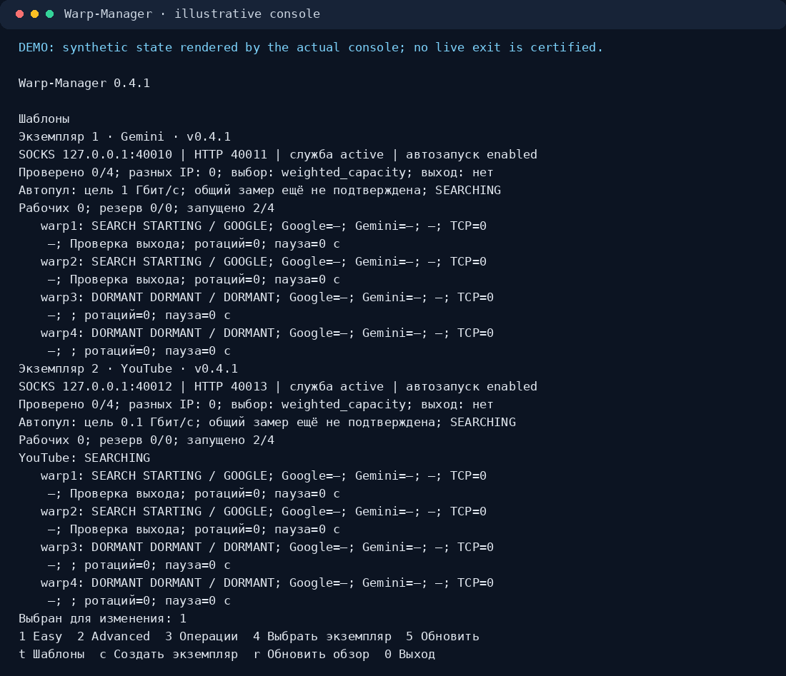

# Warp-Manager

[English](README.md) · [فارسی](README.fa_IR.md) · [العربية](README.ar_EG.md) · [中文](README.zh_CN.md) · [Español](README.es_ES.md) · [Русский](README.ru_RU.md) · [Türkçe](README.tr_TR.md)


Менеджер пулов Cloudflare WARP для Linux VPS: независимые режимы Gemini и YouTube, локальные SOCKS5/HTTP-прокси, watchdog каждого туннеля и автоподбор пула по скорости с горячим резервом.

[Установка](docs/INSTALLATION.md) · [Настройки](docs/CONFIGURATION.md) · [Команды](docs/COMMANDS.md) · [Xray / 3x-ui](docs/xray/README.md) · [Эксплуатация](docs/OPERATIONS.md) · [Тесты](docs/TESTING.md) · [FAQ](docs/FAQ.md)

**Версия 0.4.1.** Команда после установки — `warp-pool`. Внутренние пути и службы `warp-google-pool` сохранены для совместимости. Интерфейс консоли русский; флаги CLI одинаковы для всех языков документации.

## Быстрый старт

Нужны root, Ubuntu/Debian x86_64, systemd, `/dev/net/tun`, доступ в Интернет и Python 3.10+. Проверялась Ubuntu 24.04 с Python 3.12. Недостающие Docker/Compose и инструменты устанавливаются автоматически; существующий Docker сохраняется. Официальный клиент WARP скачивается при сборке контейнера и запускается с `--accept-tos`.

Из полного архива или клона:

```bash
cd Warp-Manager
sudo bash install.sh
```

Без аргументов в терминале открывается меню. Пункт `t` — шаблоны Gemini + YouTube / только Gemini / только YouTube. Easy и Advanced изменяют выбранный экземпляр; предварительный просмотр показывает настройки до применения.

После загрузки репозитория **Forcus356/Warp-Manager** станет доступен отдельный установщик:

```bash
curl -fsSL https://raw.githubusercontent.com/Forcus356/Warp-Manager/main/install_warp_manager.sh -o /tmp/install_warp_manager.sh
sudo bash /tmp/install_warp_manager.sh
```

Bootstrap определяет неизменяемый commit указанной ветки/тега, скачивает полный исходный код по HTTPS, проверяет структуру и показывает commit/SHA-256 перед запуском установки. До публикации можно использовать `install.sh` из этого архива. Подробности — в [руководстве установки](docs/INSTALLATION.md).

```bash
# Gemini: цель 1 Гбит/с, максимум 12 слотов вместе с резервом.
sudo bash install.sh --instance 1 --role gemini --target-gbps 1 --tunnels 12 --impersonate
# Отдельный YouTube-пул с собственными портами и регистрациями.
sudo bash install.sh --instance 2 --role youtube --target-gbps 1 --tunnels 12
warp-pool
warp-pool --all status
```

## Возможности

- До 99 независимых экземпляров и 1–128 слотов в каждом. Это пределы конфигурации, а не обещание вместимости VPS.
- Фиксированный пул с failover / least_connections либо автопул по целевой скорости.
- Цель в **Гбит/с**: `0.1` означает 100 Мбит/с. Сначала измеряется каждый выход, затем рабочий состав проверяется одновременно. Сумма отдельных проб не считается достигнутой общей скоростью.
- Горячий резерв `max(1, floor(N/3))`: 10 рабочих → 3 резервных, 30 → 10; для маленького пула минимум один резерв. Резерв принимает новые соединения после повышения в рабочие и затем пополняется.
- Отдельные проверки, отклонённые IP, backoff и лимиты ротации каждого туннеля. Неиспользованные слоты не запускают контейнеры.
- Gemini допускается только после анонимного ответа `SERVING`; `REFUSED`, `CAPTCHA` и `INCONCLUSIVE` не принимаются за успех.
- YouTube требует наблюдаемый Google-регион RU; Gemini в этом независимом экземпляре выключен. `RU VERIFIED` не гарантирует отсутствие рекламы или качество воспроизведения.
- SOCKS5, HTTP/CONNECT, loopback/частный IPv4, выгрузка Xray outbound и раздельных правил YouTube/Gemini.
- Обновления с резервными копиями, сохранение регистраций, удаление с учётом принадлежности зависимостей. Открытие меню читает сохранённый статус и не запускает сетевые пробы.

Выбора страны провайдера и PIN конкретного выхода WARP нет. Списки стран фильтруют **наблюдаемый регион Google**. Один TCP-сеанс остаётся на одном туннеле; суммарная полоса используется несколькими соединениями.

## Консоль

Превью получены настоящими функциями отрисовки с **синтетическими демонстрационными данными**. Это не доказательство найденных рабочих выходов.



[Easy](docs/assets/easy-mode-preview.png) · [Шаблоны](docs/assets/templates-preview.png) · [Текстовая версия](docs/assets/menu-demo.txt)

В главном меню показаны все экземпляры; `4` выбирает экземпляр для изменений, `r` обновляет обзор, `t` открывает шаблоны. Шаблоны создают новые экземпляры и сохраняют существующие. Enter оставляет настройку; `1/y/да` включает, `0/n/нет` выключает; `-` очищает список стран. Отмена не применяет изменения.

## Основные команды

```bash
warp-pool --instance 1 status --json
warp-pool --instance 1 check all --full
warp-pool --instance 1 speed all
warp-pool --instance 1 rotate warp2 --method registration
warp-pool --instance 1 logs -n 100
warp-pool --instance 1 capacity --gbps 1 --max-tunnels 12
warp-pool --instance 1 capacity --gbps 0 --max-tunnels 3
warp-pool --instance 1 autostart on
warp-pool --instance 1 xray
warp-pool xray-routing --youtube-instance 2 --gemini-instance 1
```

`check/search/speed/rotate` ставят запрос в очередь действующего монитора. Код 0 означает принятие запроса; результат нужно смотреть в `status` и `logs`. `--all` разрешён для status/logs/config/xray/update; массовая остановка и удаление так не выполняются. Полная справка — [COMMANDS](docs/COMMANDS.md).

## Xray / 3x-ui

Схема: `Xray → локальный SOCKS5 → выбранный WARP → Интернет`. Экспорт не меняет панель. Сохраните прежний default outbound первым и добавьте сервисные правила перед широкими правилами маршрутизации.

```bash
warp-pool xray-routing --youtube-instance 2 --gemini-instance 1 > warp-routing.json
```

[Руководство и JSON-фрагменты](docs/xray/README.md) объясняют порты, host/Docker, sniffing, передачу доменов в WARP и ограниченный QUIC fallback. SOCKS UDP ASSOCIATE не реализован.

## Обновление и удаление

```bash
warp-pool --instance 1 update /root/Warp-Manager
warp-pool --all update /root/Warp-Manager-v0.4.1.zip --sha256 "$EXPECTED_SHA256"
warp-pool --instance 2 uninstall
```

Для ZIP используйте реальную сумму из релиза. HTTPS-обновление требует `--sha256`. Standalone-установщик обновляет существующий экземпляр с `--update --instance N`; автоматическое обнаружение последнего GitHub Release не реализовано. [Эксплуатация](docs/OPERATIONS.md) описывает сохранение настроек, томов, откат и параметры `--purge-profiles` / `--purge-deps`.

## Проверки и ограничения скорости

```bash
python3 scripts/check_project.py
python3 -m unittest discover -s tests -v
python3 scripts/build_release.py
```

Автоматическим тестам нужны только стандартная библиотека Python и loopback-сокеты, без root, Docker и регистраций WARP. Изменяющие сервер staging-тесты запускаются отдельно и не входят в CI.

На обезличенном VPS с **1 vCPU / 2 GiB RAM** восемь реальных WARP прошли пробы с 8/32/64 клиентами без ошибок. При восьми клиентах 1/2/4/8 туннелей дали около **85/132/165/172 Мбит/с**. CPU достигал 100%; генератор TLS работал на том же CPU. Гигабит и 128 реальных клиентов без ошибок **не подтверждены**. Зафиксированы две анонимные пробы Gemini `SERVING`, но постоянный готовый пул с резервом не установлен. Проверка восстановления YouTube прошла при контрольной цели 100 Мбит/с.

[Методика и обезличенные результаты](docs/testing/RESULTS.md) отделяют реальные WARP-пробы от синтетического loopback-контроля и неудачных прогонов. Адреса VPS, SSH-данные, runtime-снимки и регистрационные профили в публичный проект не включены.

## Документация проекта

[Индекс docs](docs/README.md) · [Архитектура](docs/ARCHITECTURE.md) · [Участие](CONTRIBUTING.md) · [Загрузка на GitHub и выпуск](docs/PUBLISHING.md) · [История](CHANGELOG.md) · [Безопасность](SECURITY.ru_RU.md)

Неофициальный менеджер. Код распространяется по GPL-3.0-only; официальный клиент Cloudflare скачивается отдельно и сохраняет собственные условия. [LICENSE](LICENSE), [атрибуция](THIRD_PARTY_NOTICES.md), [исходные upstream notices](UPSTREAM_NOTICES.md), [сопоставление с Psiphon](FEATURE_PARITY_RU.md).
