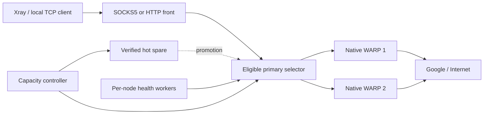

# Architecture

Warp-Manager retains the installed `warp-google-pool` layout and `warp-pool` command. The project name and public repository are independent of those compatibility identifiers.

## Components

| File | Responsibility |
|---|---|
| `warp_pool.py` | Workers, observations, quarantine, repair, TCP relay, persistence |
| `warp_capacity.py` | Individual/common measurements, primary/spare composition, resource and growth limits |
| `http_front.py` | HTTP and CONNECT over an eligible WARP SOCKS backend |
| `warp_profiles.py` | Instance identities, ports, Compose definitions, templates and Xray export |
| `warp_ctl.py` | CLI, read-only status, queued operations, update source handling |
| `warp_menu.py` | Russian Easy/Advanced drafts and instance overview |
| `warp_install.py` | Dependency setup, deployment transaction, shared CLI and removal |
| `warp_system.py` | Owned-dependency receipts and conservative cleanup |
| `warp_assets.py` | SHA-256-pinned browser profile and optional Compose binary |
| `gemini_probe.py` | Upstream anonymous Gemini generation probe |
| `worker.sh` / `tcp_bridge.py` | Native client startup, locked rotation and container proxy bridge |

## Data plane

The SOCKS front forwards TCP bytes to a selected native SOCKS endpoint; it never opens a direct Internet fallback. The HTTP front performs remote-domain SOCKS negotiation before relaying. Native clients run in proxy mode in separate containers, with persistent registration volumes. Backend ports are host-loopback-only.

A connection stays with one backend for its lifetime. Existing streams are not migrated on promotion. Fixed failover keeps a healthy active exit; least-connections distributes new streams. Capacity selection weights active plus pending stream counts by recent measured throughput. A pending connect counts immediately to avoid a burst selecting one apparently idle backend.

## Health and safety of observations

Each node independently verifies WARP transport, reads the Google GL signal, optionally probes Gemini and rechecks transport identity. Only `SERVING` is accepted for Gemini. YouTube instead requires GL=RU and disables Gemini. An observed identity change quarantines the node before a slow model call finishes. A known bad result is excluded before final verification. Rotation requires confirmations or network thresholds, plus the node's persisted limits/backoff.

A native exit can change without a requested registration reset. A trace IP is evidence for that request, not a guarantee of the exact address family/IP used by every destination or an authenticated Google account. Domain forwarding and client-path checks remain important.

## Capacity plane

Unused slots have Compose profiles and are not started with the default service set. The controller allocates gradually, serializes individual probes, then uses a common wall-clock interval for simultaneous primary downloads. Only real received bytes count. A final empty timeout after earlier data does not erase the prior bytes; an entirely empty trial, early failure, HTML or HTTP error does not certify capacity.

When sufficient primary bandwidth is measured, spares are filled to `max(1, floor(N/3))`. They pass the same service policy and have their own measurements but do not take new user traffic until promoted. A changed composition invalidates the old aggregate. The controller stops excess slots, limits concurrent search, checks host resources and pauses unproductive expansion.

## Restart and persistence

A file lock prevents concurrent managers per instance. `runtime.json` preserves rate limits, backoff, rejected IPs and allocated slots, not READY. Model results and measured readiness are re-established. State output includes manager PID, boot identity and timestamp; the CLI rejects stale cached readiness. Rotation has a lock and timeout inside the container so killing a Docker exec client cannot start overlapping mutations.

Installation builds/stages first, backs up selected files and replaces the selected instance transactionally. The shared CLI is switched through a staged directory and restored if switching fails. The [tests](TESTING.md) cover these failures independently of real provider availability.
